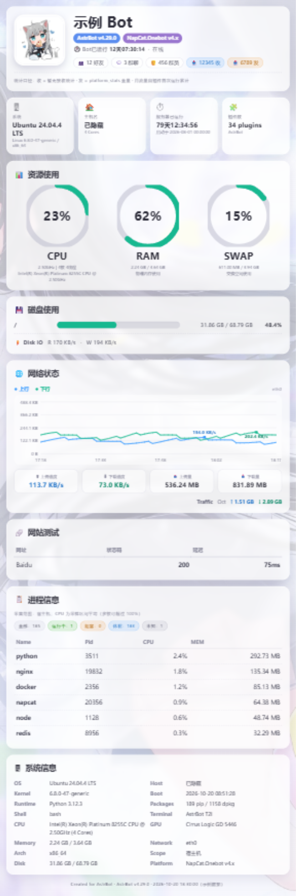

# 系统状态卡片

把服务器的 CPU、内存、磁盘、网络、进程等信息，做成一张状态图发到 QQ 群；需要时还能在服务掉线、资源过高或每天固定时间主动通知你，并发送资源/异常/QQ/Token 日报。

> **默认就能用。** 安装并重载插件后，由管理员发送 `查看状态` 即可出图；头像默认用 QQ 头像，背景默认用内置背景，不需要先配置任何东西。

## 功能特性

- **状态卡**：头像、Bot 昵称、AstrBot / NapCat 版本、运行时长、好友/群聊/群员/收发统计
- **资源概览**：CPU / 内存 / SWAP 三个环形图、系统与主机信息、磁盘占用
- **网络与磁盘**：实时上下行速度、本月流量、网络折线图、磁盘读写速度
- **网站测试**：在卡片上显示指定网站的访问状态和延迟（默认只测百度）
- **进程信息**：进程状态统计 + CPU 占用最高的进程表
- **主动告警**：资源阈值、Bot 掉线/恢复、每日定时状态图、Komari Webhook 转发
- **服务监测**：网站、端口、Docker 容器、系统服务、进程的可用性监测，异常/恢复推送到 QQ 群
- **每日日报**：每天定时发送资源趋势、异常汇总、QQ 趋势和 Token 消耗；图片失败回退文字；默认关闭，可用 `预览日报` 手动查看

## 效果预览



示例图使用脱敏配置生成，主机名、进程名和 QQ 统计已隐藏；实际卡片会显示真实数据。

## 平台支持

本插件面向 **QQ / OneBot（aiocqhttp，推荐 NapCat）**。

好友数、群聊数、群员数、Bot 头像、NapCat 版本等数据都依赖 OneBot 接口；Telegram、Discord、飞书、WebChat 等平台没有适配，`查看状态` 会直接提示“不支持”，不再生成缺数据的卡片。`状态卡诊断` 仍可在这些平台用于检查插件状态（仅管理员）。

## 安装

### 环境要求

- AstrBot `>=4.26.7,<5`（已在 4.29.0 验证）
- Python 3.10+
- 一个可用的 QQ / OneBot 连接（推荐 NapCat）
- 能访问 AstrBot 配置的 T2I 渲染服务（默认远程）

### 安装步骤

1. 把 `astrbot_plugin_statuscard` 目录放到 AstrBot 的 `data/plugins/` 下，或在插件市场安装。
2. 安装依赖：`pip install -r requirements.txt`。部分 AstrBot 版本会自动处理插件依赖。
3. 重启 AstrBot，或在 WebUI 的插件管理页重载插件。
4. 确认 AstrBot 的 T2I 渲染服务可用（默认即可）。
5. 由 AstrBot 管理员在私聊发 `查看状态`，或在群里发 `@bot 查看状态`。

> 所有命令都仅 AstrBot 管理员可用。普通群友触发不会执行，也不会出图。

## 快速开始

第一次使用只需要记住三件事：

1. **直接发 `查看状态`**：默认配置就能出图。
2. **想换头像/背景**：进插件配置页，把“头像来源”或“背景来源”改成“自定义上传”，上传图片后保存。
3. **想收告警**：在“主动告警”里打开开关，填一个 QQ 群号；需要服务监测时再到“服务可用性监测”里添加目标。
4. **想看日报**：在“日报”里开启每日日报，或直接用 `预览日报` 查看昨日汇总。

## 命令

| 命令 | 说明 |
|---|---|
| `查看状态` | 生成并发送状态图（仅管理员） |
| `测试通知` | 向当前会话发送一条测试通知，验证推送链路（仅管理员） |
| `立即检测` | 立即检查所有监测目标，只返回异常项和汇总（仅管理员） |
| `状态卡诊断` | 输出平台、OneBot、告警/监测/静默状态、最近采集与渲染耗时、最近推送结果（仅管理员） |
| `预览日报` | 生成昨日日报并发送到当前会话（仅管理员） |

### 触发方式

- 私聊：直接发 `查看状态`
- 群聊：`@bot 查看状态`
- 状态查询只保留 `查看状态` 一个命令，不再注册其他别名

## 配置页导览

配置页只有六个分组，默认只显示最常用的项目；带“高级”字样的开关打开后，才会出现更多选项。

### 头像

- **头像来源**
  - `默认（QQ 头像）`：自动使用 Bot 的 QQ 头像
  - `自定义上传`：显示上传按钮，上传一张图片即可
- **上传头像图片**（仅自定义上传时显示）：支持 png / jpg / webp / gif，单张不超过 10 MB，取列表第一张
- **状态图显示的 Bot 名称**：留空自动读取 QQ 昵称

### 背景

- **背景来源**
  - `默认（内置背景）`：使用插件自带背景
  - `自定义上传`：显示上传按钮，上传一张图片即可
- **上传背景图片**（仅自定义上传时显示）：支持 png / jpg / webp / gif，单张不超过 10 MB，取列表第一张
- 聊天中随命令一起发送的图片仍然优先于这里设置的背景

### 状态卡显示

- **输出图片宽度（像素）**：1170–2880，拖动滑块或直接输入数字。数值越大越清晰、文件越大、出图越慢；高度会随内容自动扩展。默认 1170，与旧版高清效果相当
- **进程表显示条数**：卡片上展示 CPU 占用最高的前几个进程
- **手机紧凑模式**：隐藏系统信息表，进程表最多 5 行，放大资源百分比
- **出图前发送“生成中”提示**：建议开启
- **显示高级显示选项**：打开后可配置冷却、网站测试、磁盘路径、时区、脱敏、隐私提示、渲染超时等

### 主动告警

- **启用资源与掉线告警**：默认关闭
- **推送目标**：填 QQ 群号即可，例如 `123456789`；也支持 `default:GroupMessage:123456789`
- **每日定时状态图**：独立开关，可设置每天发送时间和是否发图片（关闭则发文字）
- **显示高级告警选项**：打开后可配置 CPU/内存/SWAP/磁盘阈值、每核负载、采样间隔、连续次数、冷却、掉线通知、Komari Webhook

> 每日定时状态图和服务监测默认复用“推送目标”，通常只需要在这里填一次。

### 服务可用性监测

- **启用服务监测**：默认关闭
- **监测推送目标**：留空自动使用上面的告警推送目标
- **监测目标列表**：点“添加条目”，按类型填写
  - 网站 / 接口：名称 + 网址
  - 端口：名称 + 主机 + 端口
  - Docker 容器：名称 + 容器名
  - 系统服务：名称 + 服务名（如 `nginx.service`）
  - 进程：名称 + 进程名或命令行关键字
- **显示高级监测选项**：轮询间隔、连续失败次数、冷却、恢复通知、维护静默截止时间、HTTP 最大读取字节数
- **维护静默**：`silence_until` 填 `YYYY-MM-DD HH:MM`，到期前只探测、不发送异常/恢复通知；到期自动恢复
- **重复层抑制**：HTTP 监测项的高级选项可填 `suppress_when_down`，指向一个容器/服务监测项；依赖项异常时不再重复推送本 HTTP 告警

> 监测项类型未知、或缺少网址/端口/容器名/服务名/进程关键字时，插件启动会在日志中给出 warning，不会静默跳过；填完可以用管理员命令 `立即检测` 验证。

### 日报

- **启用每日日报**：默认关闭；开启后按设定时间发送到“推送目标”
- **发送时间**：默认 `21:00`，建议与每日定时状态图错开
- **推送目标**：留空复用“主动告警”的推送目标
- **日报内容**：资源趋势 / 异常汇总 / QQ 趋势 / Token 消耗，可勾选
- **发送图片**：关闭或图片失败时发送文字摘要
- **趋势天数**：7 / 14 / 30 天
- **记录日报历史数据**：默认开启；每 5 分钟记录资源占用，每天记录好友/群/群员和接收累计，并记录告警/监测事件
- 资源、QQ 数量、接收量和异常事件从启用后开始积累；前几天会显示“数据积累中”，不会伪造历史
- 即使未开启定时发送，管理员也可以发送 `预览日报` 手动查看昨日日报

## 常见场景

### 换头像

1. 打开插件配置页 → “头像”
2. 头像来源选择“自定义上传”
3. 上传一张图片
4. 保存并重载插件
5. 发一张状态卡确认

### 换背景

1. 打开插件配置页 → “背景”
2. 背景来源选择“自定义上传”
3. 上传一张图片
4. 保存并重载插件

### 开每日定时状态图

1. “主动告警” → “推送目标”填群号
2. “每日定时状态图” → 打开启用开关
3. 设置发送时间，例如 `20:00`
4. 保存后重载插件，日志会显示下一次发送时间

到点后发送的是**整张状态卡图片**，不是单独的统计报表或趋势图；如果图片渲染失败，才会改发一条文字摘要。

### 每日定时状态图实际是什么

- 默认在设定时间把当前状态卡图片发到“推送目标”
- 图片内容和手动 `查看状态` 基本一致
- 图片渲染失败时，发送一条包含 CPU、内存、磁盘、网络、进程、好友/群/收发的文字摘要
- 不会做昨天/今天对比，也不会生成单独的“日报”版面

### 开资源/掉线告警

1. “主动告警” → 打开“启用资源与掉线告警”
2. 填“推送目标”
3. 需要改阈值时，打开“显示高级告警选项”
4. 用管理员命令 `测试通知` 验证推送链路

### 加一个网站监测

1. “服务可用性监测” → 打开“启用服务监测”
2. 确认“推送目标”（留空会复用告警目标）
3. “监测目标列表” → 添加条目 → 选择“网站 / 接口”
4. 填名称和网址，例如 `博客`、`https://example.com`
5. 保存后用 `立即检测` 验证

### 加一个 Docker 容器监测

1. 添加条目 → 选择“Docker 容器”
2. 名称填 `NapCat`，容器名填 `napcat`
3. 保存后测试。运行 AstrBot 的系统用户需要有 Docker 权限

### 加一个系统服务监测

1. 添加条目 → 选择“系统服务”
2. 名称填 `Nginx`，服务名填 `nginx.service`
3. 保存后测试

### 接入 Komari Webhook

1. 打开“主动告警” → “显示高级告警选项”
2. 展开“Komari Webhook”，打开“启用 Webhook 接收”
3. 默认监听 `127.0.0.1:9968/webhook`
4. 在 Komari 后台添加 Webhook，Body 用 `{"title":"{{title}}","message":"{{message}}"}`
5. 如果设置了 Token，在请求头加 `Authorization: Bearer <token>`
6. 如果 Webhook 需要暴露到本机以外，建议同时打开“强制要求 Token”；未配置 Token 时插件会拒绝启动 Webhook，而不是无鉴权接收

## 权限与隐私

- 所有命令都需要 AstrBot 管理员权限；普通用户无法触发状态卡或管理命令
- 状态图会发送到 AstrBot 配置的 T2I 渲染服务（默认 `https://t2i.soulter.top/text2img`），其中包含主机名、进程名、磁盘、网络、头像/昵称等
- 上传的头像/背景只保存在本机 `data/plugin_data/astrbot_plugin_statuscard/files/...`，不会上传到插件作者的服务器
- 插件会访问 QQ 头像地址 `q1.qlogo.cn`，以及“网站测试目标”中配置的网站
- 如果不想暴露主机名、进程名、网络或 QQ 统计，打开“显示高级显示选项”，在“状态卡脱敏项”中勾选对应项目
- 公开群使用前，建议至少隐藏主机名和进程信息
- 日报数据库 `data/plugin_data/astrbot_plugin_statuscard/report.db` 只保存资源数值采样、QQ 数量/接收累计、异常事件和日报生成记录；不保存消息内容、用户 ID、UMO 或 Token 密钥
- `state.json` 和 `report.db` 在 Linux 下会尝试设置为 600 权限；资源数据默认保留 30 天，事件默认保留 90 天

## 数据口径

- **发**：读取 AstrBot 数据库 `platform_stats` 的累计值。AstrBot 只在发送路径累加该表，因此是真实的“发”
- **收**：读取 `astrbot_plugin_message_stats` 的群统计 JSON，只覆盖该插件跟踪的群，图上会标注口径
- **群员**：`get_group_list` 返回的各群 `member_count` 之和；同一用户跨群会重复计数
- **月流量/网络折线**：插件每 60 秒采样 `psutil.net_io_counters`，从插件首次运行开始累计，状态保存在 `state.json`，重启不丢
- **网络折线**：图上绘制最近 60 个采样点（默认约 1 小时），采样历史最多保留 180 个点；纯 SVG 绘制，不依赖 JS

## 高级配置

只有需要排错或精细调整时才需要看这部分。

| 配置项 | 默认值 | 说明 |
|---|---|---|
| `display.render_width` | `1170` | 输出图片宽度，1170–2880 像素；内部按 T2I 的 1.8 倍高清倍率换算 |
| `display.compact` | `false` | 手机紧凑模式；隐藏系统信息表、进程最多 5 行、放大资源百分比 |
| `display.render_timeout` | `180` | 渲染超时（秒）；超时后回退为文字摘要 |
| `display.cooldown_seconds` | `10` | 同一会话冷却；0 表示不限制 |
| `display.website_targets` | Baidu | 网站测试目标；默认只测百度，可增删 |
| `display.website_cache_seconds` | `60` | 网站测试缓存；0 表示每次重新请求 |
| `display.disk_paths` | 空 | 磁盘挂载点；留空自动检测，Linux 通常填 `/` |
| `display.timezone` | `Asia/Shanghai` | 卡片、告警、监测和日报统一使用的时区 |
| `display.redact` | 空 | 脱敏项：主机名 / 进程信息 / 网络数据 / QQ 统计 |
| `alerts.cpu_threshold` 等 | CPU 85 / 内存 90 / SWAP 90 / 磁盘 85 / 每核负载 2.0 | 资源阈值；打开“显示高级告警选项”后可调 |
| `alerts.interval_seconds` | `60` | 告警采样间隔（秒） |
| `alerts.sustain_samples` | `3` | 连续超过阈值几次才告警 |
| `alerts.cooldown_seconds` | `1800` | 同一规则告警冷却（秒） |
| `monitors.interval_seconds` | `60` | 服务监测轮询间隔（秒） |
| `monitors.fail_threshold` | `2` | 连续失败几次后告警 |
| `monitors.silence_until` | 空 | 维护静默截止时间，`YYYY-MM-DD HH:MM`；到期前只探测不推送 |
| `monitors.max_response_bytes` | `262144` | HTTP 关键字检查最大读取字节数 |
| `monitors.items[].suppress_when_down` | 空 | HTTP 监测项依赖的另一个监测项名称；依赖项异常时抑制本项告警 |
| `alerts.komari_webhook.require_token` | `false` | 强制要求 Webhook Token；开启但未配置 Token 时拒绝启动 Webhook |
| `daily_report.enabled` | `false` | 启用每日定时日报 |
| `daily_report.time` | `21:00` | 日报发送时间，24 小时制 `HH:MM` |
| `daily_report.targets` | 空 | 日报推送目标；留空复用 `alerts.targets` |
| `daily_report.sections` | 全部 | 勾选资源 / 异常 / QQ / Token |
| `daily_report.with_image` | `true` | 发送图片；关闭或失败时发文字摘要 |
| `daily_report.history_days` | `7` | 趋势天数，7–30 天 |
| `daily_report.render_timeout` | `180` | 日报渲染超时（秒） |
| `daily_report.collect` | `true` | 记录日报历史数据 |
| `daily_report.resource_sample_seconds` | `300` | 资源采样间隔（秒） |
| `daily_report.retention_days` | `30` | 资源数据保留天数 |
| `daily_report.event_retention_days` | `90` | 异常事件保留天数 |

### 配置文件位置

- 插件配置：`data/config/astrbot_plugin_statuscard_config.json`
- 运行状态：`data/plugin_data/astrbot_plugin_statuscard/state.json`
- 上传图片：`data/plugin_data/astrbot_plugin_statuscard/files/...`

修改配置后，保存时 AstrBot 会自动热重载插件；如果修改后没有生效，可以手动重载插件或重启 AstrBot。

## 常见问题

### 不配置能用吗？

能。默认会使用 QQ 头像、内置背景，网站测试只测百度，告警和服务监测默认关闭。

### 上传头像/背景后没有生效

- 确认“头像来源/背景来源”已经选择“自定义上传”
- 确认已经保存配置并重载插件
- 上传图片会取列表第一张；单张不能超过 10 MB
- 支持 png / jpg / webp / gif
- 如果来源选了“自定义上传”但没有上传文件，会回退 QQ 头像/内置背景，并在日志中提示

### 出图很慢

主要耗时在远程 T2I，不是采集。可以把“输出图片宽度”调小，或保留“出图前发送‘生成中’提示”。采集本身通常只需要 1 秒左右。

### 好友/群/群员显示 `--`

通常是 NapCat/OneBot 未连接，或 `get_friend_list` / `get_group_list` 超时。插件会在 30 秒后重试失败字段。检查：

```bash
systemctl status napcat
journalctl -u astrbot -n 100 --no-pager | grep -i statuscard
```

### 每日定时状态图没有发

确认：

- “每日定时状态图”已启用
- 发送时间是 `HH:MM`，例如 `20:00`
- “推送目标”不为空
- 时区正确（默认 `Asia/Shanghai`）
- 每日定时状态图发送的是整张状态卡图片；图片失败时才发文字摘要
- 日志：`journalctl -u astrbot --since "10 minutes ago" | grep 每日定时状态图`

### 告警/监测没有收到

- 资源告警看“启用资源与掉线告警”
- 服务监测看“启用服务监测”和“监测目标列表”
- 推送目标可以填纯群号，也可以填完整 UMO
- **想在群里验证推送**：在接收告警的群里发送 `@bot 测试通知`（需要管理员）
- 管理员可以用 `测试通知`、`立即检测` 验证链路
- 服务监测需要连续失败达到设定次数才会告警，短暂抖动不会报
- 插件不监测 AstrBot 自身的 WebUI/进程；AstrBot 重启时插件也不在运行，无法自己告警自己
- Uptime Kuma 的邮件通知和本插件的群告警是两套通道；Uptime Kuma 监控 AstrBot WebUI 的 Down/Up 不会自动变成 QQ 群消息。这类 AstrBot 自身故障请用外部 Uptime Kuma / Komari 监测

### 掉线/恢复告警为什么没收到

- 掉线检测依赖同一个 QQ/OneBot 通道；AstrBot、NapCat 或 QQ 整体断开时，告警本身也发不出去
- 插件会在连接恢复后补发“离线 + 恢复”合并通知
- AstrBot 进程被重启或杀掉时插件不在运行，无法自己告警自己；这种情况建议用外部 Komari / Uptime Kuma 监测 AstrBot

### Docker/系统服务监测失败

- Docker 检查需要运行 AstrBot 的系统用户有 Docker 权限
- 系统服务使用 `systemctl is-active` 检查，服务名要带 `.service`，例如 `nginx.service`
- 端口监测填本机服务时，主机用 `127.0.0.1`

### WebChat/其他平台显示 `--`

本插件只支持 QQ / OneBot（aiocqhttp）。其他平台发送 `查看状态` 会直接收到“当前平台不受支持”，不再生成缺数据的卡片；`状态卡诊断` 仍可用于检查插件状态（仅管理员）。

### 日报在哪里看

- 管理员发送 `预览日报`，会立即生成昨日日报并发送到当前会话。
- 在“日报”里开启“启用每日日报”后，每天在设定时间自动发送；推送目标留空时复用“主动告警”的目标。
- 前几天资源 7 天趋势、QQ 快照和接收趋势会显示“数据积累中”，因为历史数据从启用后才开始记录；发送量和 Token 可以回填 AstrBot 历史数据库。
- `状态卡诊断` 会显示日报开关、发送时间、目标数量、内容模块和最近一次发送结果。

### 如何卸载和数据清理

删除插件目录、`data/config/astrbot_plugin_statuscard_config.json` 和 `data/plugin_data/astrbot_plugin_statuscard/` 即可。卸载前建议先备份 `state.json`；如需保留日报历史，同时备份 `report.db`。

## Roadmap

- **日报可选模块**：待办记录、网站延迟趋势、Top 异常进程、图片分页/压缩
- **多机器人完整支持**：按监测项/告警目标配置平台，真实双账号验证
- **通知渠道**：邮件、出站 Webhook、其他 IM 平台
- **状态页/历史看板**：把 `report.db` 的趋势数据用于 Web 查看
- **公开发布**：插件市场、公开仓库、issue 模板和安全策略（当前仓库私有）

## 开发与测试

测试使用 pytest，不依赖 AstrBot 运行时：

```bash
cd astrbot_plugin_statuscard
python -m pytest -q
```

当前测试预期为 `39 passed`。GitHub Actions 工作流见 `.github/workflows/ci.yml`，在 push 和 pull request 时安装依赖并运行同一套测试。

## 更新日志

见 [CHANGELOG.md](CHANGELOG.md)。

## 关于

- 作者：烬辞
- 仓库：<https://github.com/SX0YYYY/astrbot_plugin_statuscard>（私有）
- 许可证：AGPL-3.0
- 本项目基于 [astrbot_plugin_picstatus](https://github.com/exynos967/astrbot_plugin_picstatus)（作者：薄暝 / exynos967）二次开发，上游同样使用 AGPL-3.0；详见 [ATTRIBUTION.md](ATTRIBUTION.md) 与 [LICENSE](LICENSE)

再分发时请保留上游署名与完整源代码。
